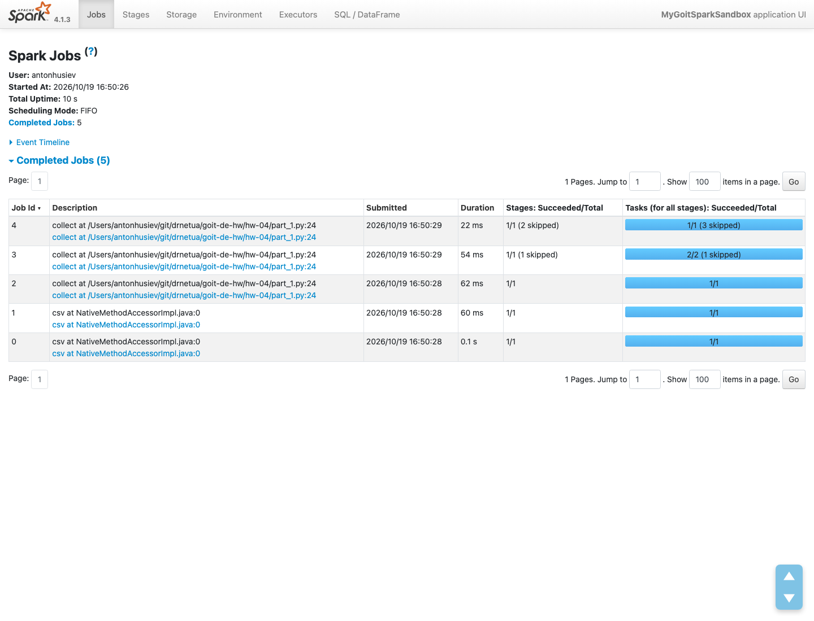
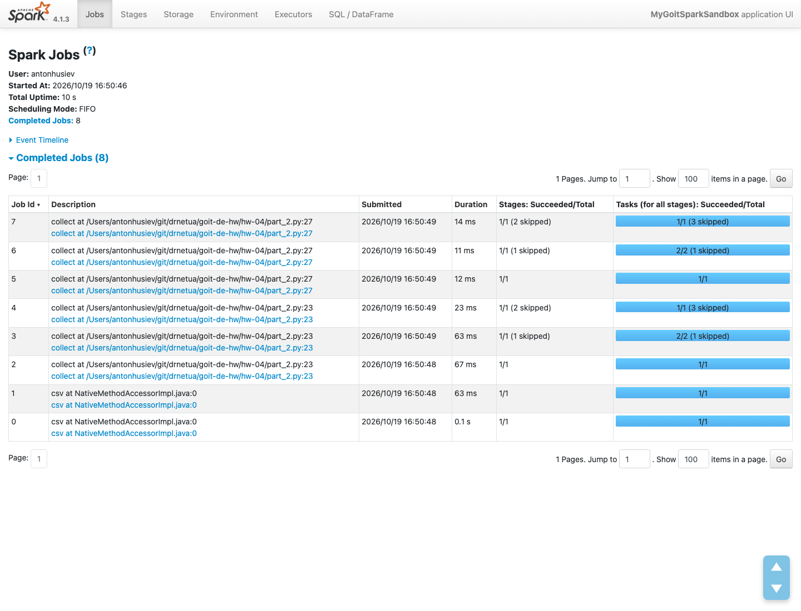
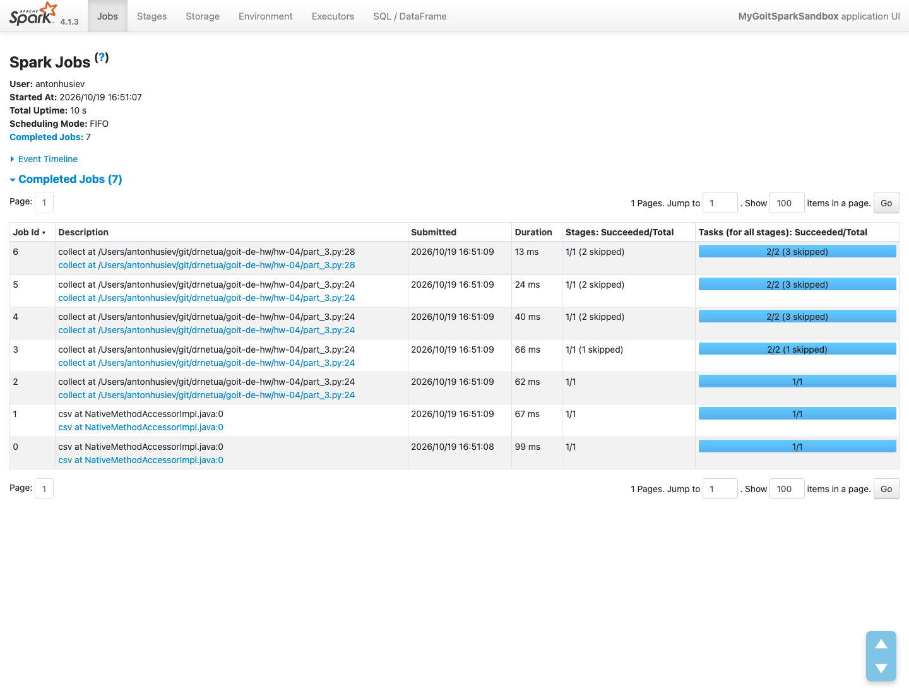

# Homework 04: Apache Spark optimization and Spark UI

Run three versions of the same query over the SF Fire Department calls dataset (`nuek-vuh3`) and compare their jobs in Spark UI: plain, with an extra intermediate `collect()`, and with `cache()` on the intermediate result.

The code is the one given in the assignment, wrapped in a `run(spark)` function so the tests can count jobs.

## How to run

Requires [uv](https://docs.astral.sh/uv/) and Java 17 or 21 on `PATH` (Spark 4.1 doesn't run on Java 25).

The dataset (1000 rows) is in `data/nuek-vuh3.csv`. `./run.sh` sets up the venv, runs the tests, then runs `part_1.py`, `part_2.py` and `part_3.py` one after another. It presses Enter for them, so Spark UI closes right away. To look at the UI, run a part directly with `.venv/bin/python part_1.py` and open http://localhost:4040/jobs/ while it waits.

## Results

Run output: [results/output.txt](results/output.txt), tests: [results/tests.txt](results/tests.txt). Every part returns the same single row: one `unit_id` with more than 2 calls of priority below 3.

### Part 1: 5 jobs

- Jobs 0-1: reading the CSV. One job reads the header, one scans the file for `inferSchema`.
- Jobs 2-4: the final `collect()`. With adaptive query execution each shuffle stage runs as its own job: `repartition(2)`, then the `groupBy` shuffle, then the result stage with `count>2`.

### Part 2: 8 jobs

The intermediate `collect()` is a separate action, so Spark runs the whole plan for it: jobs 2-4. The final `collect()` doesn't reuse anything and runs the same three jobs again: 5-7. The CSV is read only once, when the DataFrame is created. That's 2 + 3 + 3 = 8, three more than in part 1.

### Part 3: 7 jobs

- Jobs 0-1: reading the CSV.
- Jobs 2-5: the intermediate `collect()`. The two shuffles, then a job that builds the cached partitions, then one that reads them back.
- Job 6: the final `collect()`. It reads the cached `groupBy` result and only applies `count>2`, no shuffles.

`cache()` is lazy: it only marks the DataFrame, and the first action stores the result in memory. Filling the cache costs one extra job, but every later action on that DataFrame starts from memory instead of rereading the CSV and shuffling again. Here it saves one job; with more actions on the same DataFrame the savings grow. `spark.catalog.clearCache()` frees the memory at the end.
